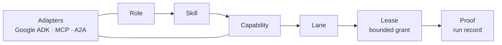

# echo-adk

Echo Agent Development Kit: an Echo-native agent core — **Role, Skill,
Capability, Lane, Lease, Proof** — with Google ADK, MCP, and A2A adapters.
It is the kit behind the fleet's Echo bots and ADK agents on
echoomegaprime.com: agents and bots are created, inspected, paused, resumed,
and run through one contract.

## Status

Bootstrapping. The core is being built on the `agent/echo-adk-core-20261104`
branch; this file is replaced by the full README when that branch merges.
The live contract service (`echo-adk-api`) runs on FORGE and is what the
EchoBots + Echo ADK connector talks to today.

## The core model

| Concept | Meaning |
|---|---|
| **Role** | Who the agent is — its persona and mandate |
| **Skill** | A reusable playbook the agent can execute |
| **Capability** | A single governed action the agent may invoke |
| **Lane** | The execution channel a run travels in |
| **Lease** | A bounded, revocable grant to act |
| **Proof** | The verifiable record a run leaves behind |

## License

MIT, Echo Prime Tech LLC.
